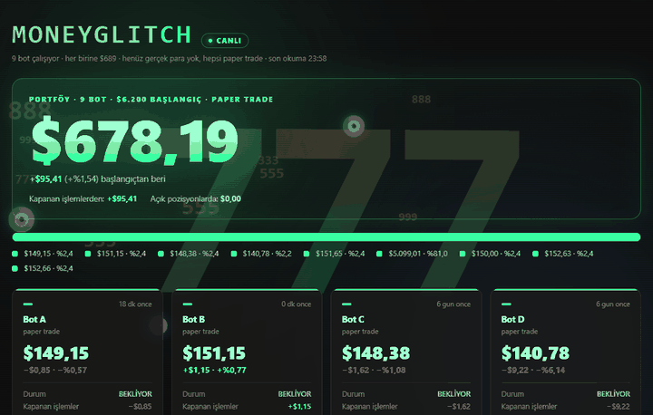

  

  

I build trading systems that have to *prove* their edge before they touch real money, and AI agents that do real work: from a desktop assistant on the Claude Agent SDK to a Minecraft companion that turns chat into actions.

- 📈 Research → validation → paper → live pipeline for crypto, forex and index futures
- 🤖 LLM agents with a strict rule: the model translates intent, the code executes
- 🍓 My bots run 24/7 on a Raspberry Pi, monitored through Telegram

## Tech stack

  

## Featured projects

### [quant-lab](https://github.com/lordinek/quant-lab)
Research and validation framework for intraday trading models: look-ahead and recursive-bias checks, random-entry control, parameter robustness, out-of-sample and rolling-window tests, plus a prop-firm challenge simulator. It ships with a retired strategy as a case study of a model that *looked* profitable until validation found the bug.
`Python` `pandas` `numpy` `pytest`

### [noyan-desktop](https://github.com/lordinek/noyan-desktop)
A desktop AI agent built on the **Claude Agent SDK** and Electron. It keeps one streaming agent session with live permission cards, model and permission-mode switching, multimodal input, session resume, and side panels that read an Obsidian second-brain vault.
`Electron` `Claude Agent SDK` `Node.js`

### [minecraft-ai-companion](https://github.com/lordinek/minecraft-ai-companion)
An autonomous Minecraft companion that takes orders in natural language. Gemini turns chat into a validated JSON task queue; deterministic code handles mining, crafting, farming, building and combat. It also has a mood system, an LLM-free in-game dialog menu, and a server-side Fabric mod.
`Mineflayer` `Gemini API` `Fabric / Java`

## Live trading dashboard

  

MONEYGLITCH: my live paper-trading dashboard, with real balances from the Raspberry Pi. Bot names and strategies are anonymized.

## Also built (private)

- **Live trading stack**: several paper-trading bots on Bybit/Binance. A daily reconciliation report checks live fills against the backtest (312 live trades, 100% match), slippage and news-window filters are measured, and a web dashboard tracks it all.
- **Pi infrastructure**: 11 services on a Raspberry Pi 3 with systemd and a Wake-on-LAN Telegram gatekeeper that can boot the home PC remotely.
- **Telegram ↔ Claude bridge**: control an AI agent on the home PC from my phone, with inline approval buttons.
- **Discord community bot**: TypeScript + Prisma, with XP levels, badge roles, leaderboards, automod and stat panels.

## Latest on YouTube

I turn the AI projects into videos: Minecraft agents, bots vs. cheaters, behind-the-scenes builds.

<!-- YOUTUBE:START --><!-- YOUTUBE:END -->

## GitHub stats

  

  

  <picture>
    <source media="(prefers-color-scheme: dark)" srcset="https://raw.githubusercontent.com/lordinek/lordinek/output/snake-dark.svg" />
    
  </picture>

  

